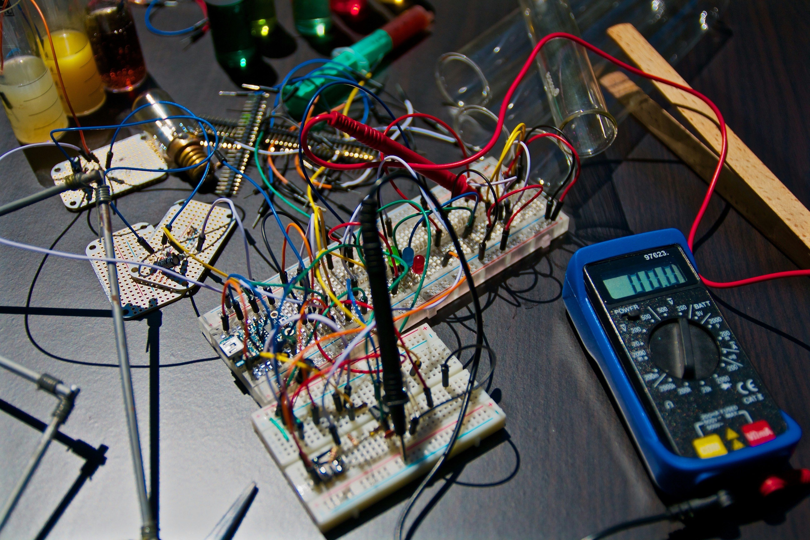
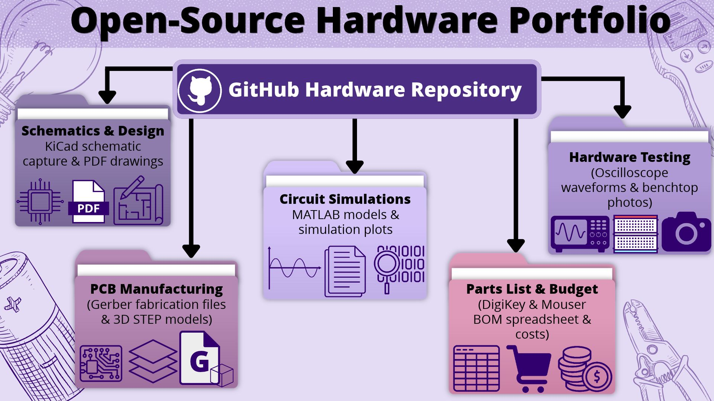

# Graduation Learning Plan For A Career In Electrical Design Engineering

© Photo Nicolas Thomas, Unsplash

---

**Prepared for:** Husky student pursuing a job as an Electrical Design Engineer   
**Prepared by:** Edan Tsegaye   
**Date:** October 27, 2026   

---

## Table of Contents 
- [Purpose](#purpose)
- [Mastering circuit design through hands-on projects](#mastering-circuit-design-through-hands-on-projects)
- [Utilizing open-source tools and industry standards](#utilizing-open-source-tools-and-industry-standards)
-  [Gaining practical experience on campus](#gaining-practical-experience-on-campus)
- [Building professional networks through local organizations](#building-professional-networks-through-local-organizations)
- [References](#references)

## Purpose 
Your coursework, you learn circuit theory, but employers hire entry-level electrical design engineers for what you can build, document, and explain. Graduates who have never laid out a board, managed a parts budget, or worked on a technical team compete against applicants who have. This plan covers four areas that close the gap between the classroom and the job: hands-on projects, open-source tools and standards, campus experience, and professional networks. It shows you how to build the experience that makes you stand out, so you are ready for your career, not just the degree.

## Hands-on projects
Electrical design engineering requires hands-on experience building circuits and laying out circuit boards, more than memorizing formulas.[^1] Employers look for students who have experience building hardware and can take a design from schematic to a product.[^2]

**Build your own independent electronics projects, from a breadboard prototype to a custom PCB design in KiCad.** Practice working under a budget by managing part numbers on websites like DigiKey, which builds experience navigating real-world supply chain practices. Document your progress, and note what went well and what challenged you. Because employers cannot judge a project they can't see, and utilizing open-source hardware treats a version-controlled repository as the standard way to share design files, parts lists, and photos.[^3]

**When you finish a project, post your design and what you learned in a GitHub repository organized like Figure 1.** Give the schematics, PCB manufacturing files, circuit simulations, hardware testing results, and parts list and budget their own folders.

**Figure 1: Anatomy and Architecture of an Open-Source Hardware Portfolio Repository**

  
*Source: Based on open-source hardware documentation standards.*[^3]

## Open-source tools and standards
Electrical design teams usually use vendor schematics, open-source designs, and published standards to help speed up projects.

**Read the relevant industry standard and a manufacturer application note before you lay out each board.** Find standards through the UW Libraries,[^4] and find application notes from chip designers like Texas Instruments to see how engineers lay out their boards. Citing official sources on your projects shows you are already thinking like an industry professional.

Juan Martinez, who leads the antenna team at Cisco, starts nearly every design with simulation, which helps his team save time by not having to build many hardware prototypes.[^5]

**Simulate each circuit before you order parts.** Use MATLAB, which is free with your UW email.[^6]

## Campus experience
A strong background in electrical design can start on campus through clubs and student competitions. Engineers work with many teams to see a design implemented correctly,[^1] and employers look for exposure to build support and manufacturing interaction.[^2]

**Join one campus group, such as TrickFire Robotics, and take on circuit projects.** Working in the lab helps you gain direct experience designing hardware, plus practice using testing gear and troubleshooting hardware issues.

Engineers must be able to explain complex technical information orally and in writing,[^1] and a team setting tests that skill while you develop your software, CAD, and hardware design skills.

**Participate in campus events such as the annual hackathon held by ACM and ACMW, and ask for feedback from your peers and professors to better your designs and debugging skills.**

## Professional networks
Finding an engineering job depends on networking, clear communication, and getting involved with local tech groups outside of school. Juan Martinez said that a good contact can recommend you for a position and push your resume inside an organization, which is a great opportunity.[^5]

**Attend IEEE Seattle Section monthly meetings to meet engineers in industry, ask them about their daily work, and set up informational interviews.**

He also said that people favor those they already know, because humans tend to make decisions based on empathy.[^5]

**Reach out to alumni through Husky Landing to build genuine connections with former UW students and get direct advice on your resume and interview preparation.**

**Utilize Handshake to attend employer events that target Northwest companies like Blue Origin and Crane, and look into local electronics manufacturing service suppliers in Bothell for internship openings.** 

## References

[^1]: U.S. Bureau of Labor Statistics, "Electrical and Electronics Engineers," *Occupational Outlook Handbook*, 29 October 2026. [Online]. Available: https://www.bls.gov/ooh/architecture-and-engineering/electrical-and-electronics-engineers.htm. [Accessed: Nov. 22, 2026].

[^2]: K. Pratt, "Electrical Design Engineer job description: Responsibilities and skills," *redlinegroup.com*, 28 January 2026. [Online]. Available: https://www.redlinegroup.com/insight-details/electrical-design-engineer-job-description-responsibilities-and-skills. [Accessed: Nov. 22, 2026].

[^3]: Open Source Hardware Association, "Best Practices for Open Source Hardware 1.0," *oshwa.org*, 18 April 2013. [Online]. Available: https://oshwa.org/resources/sharing-best-practices/. [Accessed: Nov. 22, 2026].

[^4]: University of Washington Libraries, "Engineering Library," *lib.uw.edu*, 24 September 2026. [Online]. Available: https://lib.uw.edu/engineering/resources/englibdb/. [Accessed: Nov. 22, 2026].

[^5]: [Last name], Juan. Personal interview. [Day Month Year].

[^6]: University of Washington Information Technology, "MATLAB," *it.uw.edu*, n.d. [Online]. Available: https://it.uw.edu/uware/matlab/. [Accessed: Nov. 22, 2026].

[Word count 695]
