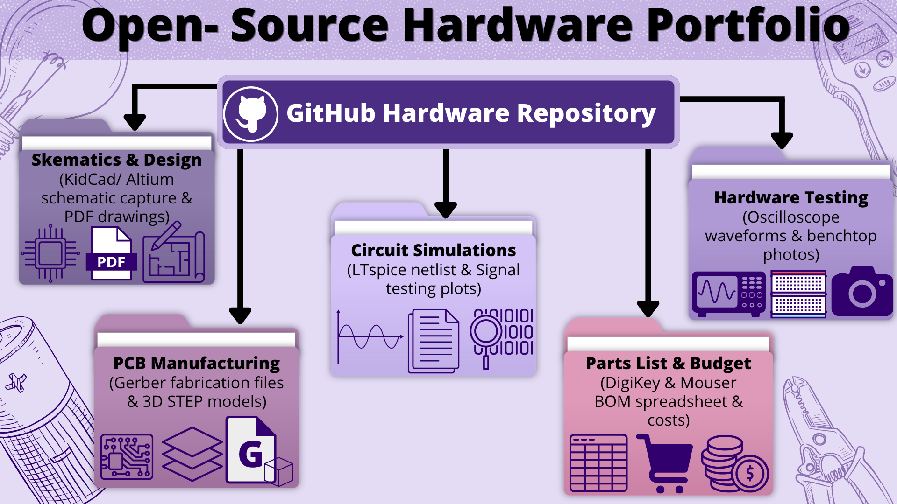

# Graduation Learning Plan For A Career In Electrical Design Engineering

© Photo Nicolas Thomas, Unsplash

---

**Prepared for:** Husky student pursuing a job as an Electrical Design Engineer   
**Prepared by:** Edan Tsegaye   
**Date:** October 27, 2026   

---

## Table of Contents 
- [Purpose](#purpose)
- [Mastering circuit design through hands-on projects](#mastering-circuit-design-through-hands-on-projects)
- [Utilizing open-source tools and industry standards](#utilizing-open-source-tools-and-industry-standards)
-  [Gaining practical experience on campus](#gaining-practical-experience-on-campus)
- [Building professional networks through local organizations](#building-professional-networks-through-local-organizations)
- [References](#references)

## Purpose 
Pursuing an Electrical Engineering career requires intentional professional development to build real-world skills employers look for. This graduation learning plan establishes best practices for Electrical Engineering students at UW Bothell to be able to gain hands-on technical experience, industry exposure, and professional skills beyond the classroom. Following these best practices prepares you to successfully apply for entry-level Electrical Design Engineer positions after graduation. 

## Mastering circuit design through hands-on projects
Electrical design engineering requires hands- on experience building circuits and laying out printed circuit boards, more than memorizing formulas [1,2]. Employers look for students who have built hardware, reverse-engineered devices, and have experience with budgeting components [2]. Taking apart electronics and building them back helps you map out power networks in low-risk environments. Then managing part numbers on websites like DigiKey helps build experience navigating real-world supply chain practices [1]. 

Build your own independent electronics projects utilizing breadboards, and make custom PCB designs in software such as KiCad or Autodesk. Practice working under a budget; document your progress, note what went well and what challenged you. Then, when you finish a project, post your design and what you learned on platforms like GitHub.  

## Utilizing open-source tools and industry standards
Taking advantage of free software, parent databases, and open-sources libraries helps you to learn professional standards without spending a lot of money [3]. 
Electrical design teams often rely on vendor schematics and open-source designs to help speed up development [3]. As a student, you have access to student discounts, IEEE Xplore through the UWB library, ANSI, and ISO standards, which help you learn how real products are designed and regulated [3]. Citing official sources on your projects shows you are already thinking like an industry professional [3].  

**Figure 1: Anatomy and Architecture of an Open-Source Hardware Portfolio Repository**

  
*Based on open-source hardware documentation standards.*

As a student, software like MATLAB, LTspice, and CAD design tools are free when you use your UW email. Research patents from local companies on Google Patents and find application notes from chip designers like Texas Instruments to see how engineers lay out their boards. Practice writing code in Python to automate things in CAD, and share your code and files.

## Gaining practical experience on campus
Building a strong background in electrical design can start right on campus through tech clubs and student competitions [1,2]. Joining campus groups such as TrickFire Robotics, UWB ACM, and the UWB Electronics Club gives you direct experience designing circuit boards, telemetry systems, and power distribution boards [2]. Working in lab spaces gives you practice using testing gear and troubleshooting hardware issues [2]. Being a part of campus organizations will also increase your network, as most clubs have connections with different industry organizations and resources [1].

Moreover, participating in campus events such as hackathons, like the annual one held by ACM and ACMW, and participating in campus design challenges will build your practical skills. Through these events, you can develop your software, CAD, and hardware design skills in a team setting. Utilize these events to seek constructive feedback from your peers and professors to refine your circuit design and debugging skills. 

## Building professional networks through local organizations
Finding an engineering job depends on networking, clear communication, and getting involved with local tech groups outside of school [1,2]. Looking beyond giant tech companies and targeting mid-sized contract manufacturers or aerospace suppliers in cities around you will give you access to entry-level roles with less competition [1]. Getting involved with the IEEE Seattle Section, the Emerging Leaders in Engineering program, and Career Services events helps to connect you with engineers and hiring managers. Reaching out to alumni through Husky Landing lets you build genuine connections with former UW students [2].

Attend IEEE Seattle Section monthly meetings to meet practicing engineers, ask them about their daily work, and set up informational interviews. Look into local electronics manufacturing service suppliers in Bothell for internship openings. Utilize Handshake to attend employer events targeting Northwest companies like Blue Origin, Gene, and Crane. Connect with former UW graduates on Husky Landing to get direct advice on your resume and interview preparation.

## References 

1] U.S. Bureau of Labor Statistics, "Electrical and Electronics Engineers," *Occupational Outlook Handbook*, U.S. Department of Labor, Aug. 27, 2026. [Online]. Available: https://www.bls.gov/ooh/architecture-and-engineering/electrical-and-electronics-engineers.htm. [Accessed Oct. 27, 2026].
[2] Redline Group & UVA Engineering Career Center, "Electrical Design Engineer Job Description, Responsibilities, and Skills," *UVA Engineering Career Center*, 2026. [Online]. Available: https://engineering.virginia.edu/offices-programs/center-engineering-career-development/career-development-electrical-engineering-job-titles-and-job-descriptions. [Accessed Oct. 27, 2026].
[3] IEEE Standards Association, "IEEE Standards and Engineering Documentation Guidelines," *IEEE Xplore Digital Library*, 2026. [Online]. Available: [suspicious link removed]. [Accessed Oct. 27, 2026].

[Word count 695]
